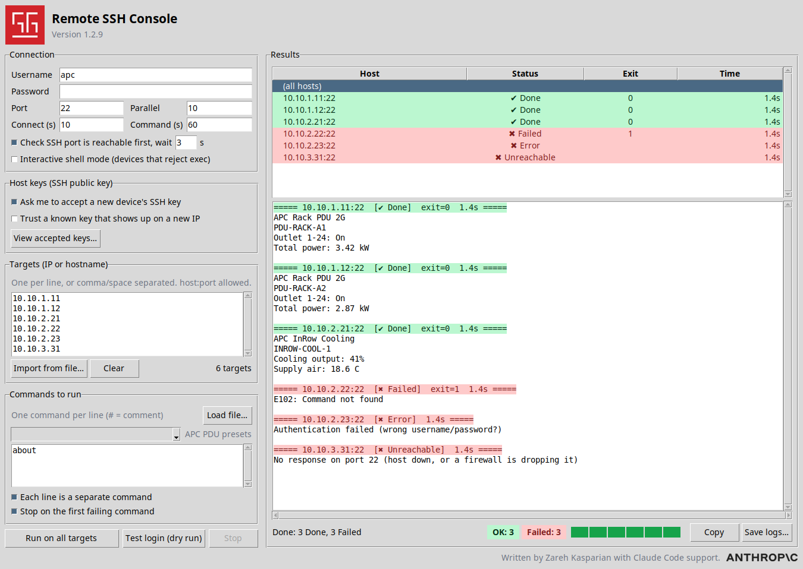

# MultiNode SSH Console

A small Python/Tkinter desktop app: run one command on many SSH devices at
once and read the output for each IP. It works with any SSH device, with
built-in command presets specially for APC products (PDUs and InRows).

Written by Zareh Kasparian with Claude Code support.



*Sample run of `about` on six example hosts (addresses and output are made
up). Green rows = command completed, red rows = failed. Bottom right: the
OK / Failed counters and the chunked progress bar.*

## Run

```
pip install -r requirements.txt   # only paramiko; Tkinter ships with Python
python3 app.py
```

On Debian/Ubuntu, Tkinter may need `sudo apt install python3-tk`.

### What `requirements.txt` is for

It lists the outside Python libraries the app needs. The only one is
**paramiko**, which does the SSH connections. `pip install -r
requirements.txt` (also run by `build_windows.bat` and the GitHub build)
installs it, and the installed version ends up inside `MultiNodeSSHConsole.exe`.

It currently says `paramiko>=2.12,<5`, i.e. "2.12 or newer, but below 5".
The `<5` limit is deliberate: paramiko 5 removed the `ssh-rsa` (SHA-1) host
key, and many older devices (e.g. APC / `cryptlib`-based management cards)
offer **only** that key type. With paramiko 5 the app
and the device have no host key in common and the connection fails with
`Incompatible ssh peer (no acceptable host key)`, even though PuTTY connects
fine. Pinning below 5 fixes it. If your devices' firmware later offers
`rsa-sha2-256` / `rsa-sha2-512`, the `<5` limit can be removed.

## Windows executable

Two ways to get a single `MultiNodeSSHConsole.exe` (no Python needed to run it):

1. **On a Windows PC:** install Python from python.org (tick *Add python.exe
   to PATH*), then double-click `build_windows.bat`. The exe appears in `dist\`.
2. **GitHub Actions:** run the *Build Windows executable* workflow (Actions tab
   -> Run workflow) and download the artifact, or push a tag like `v1.0.0` to
   get the exe attached to a release.

**Verify the download:** each release also has `MultiNodeSSHConsole.exe.sha256`
(SHA-256 checksum of the exe). Put both files in one folder and compare:

```
# Windows PowerShell
(Get-FileHash .\MultiNodeSSHConsole.exe -Algorithm SHA256).Hash
Get-Content .\MultiNodeSSHConsole.exe.sha256

# Linux / macOS
sha256sum -c MultiNodeSSHConsole.exe.sha256
```

The two hashes must be identical (PowerShell prints upper-case, the file is
lower-case - that is fine). The checksum is also shown in the build's run
summary on the Actions tab.

Windows may show a SmartScreen warning for an unsigned exe: *More info -> Run
anyway*. Accepted host keys are stored in `%APPDATA%\remote-ssh-console\known_hosts`.

## Using it

1. **Connection** - username, password, default port (22), timeouts, and how
   many hosts to connect to in parallel.
2. **Targets** - type or paste one or many addresses (newline, comma, space
   or semicolon separated), or **Import from file...** to load a `.txt`/`.csv`
   list (e.g. saved from Notepad). `10.0.0.5:2222` overrides the port for one
   host, `[fe80::1]:22` works for IPv6, and `#` starts a comment.
3. **Commands** - what to run on every host. Put **one command per line**
   (blank lines and lines starting with `#` are ignored), or use **Load
   file...** to read them from a text file.
   - *Each line is a separate command* (default): every line runs on its own
     and gets its own `$ command` section, exit code and stderr in the log.
     Untick it to send the whole text as one script instead.
   - *Stop on the first failing command* (default): if one command exits
     non-zero the remaining ones on that host are skipped and marked as such.
     Untick to run them all regardless.
   - *Built-in APC presets*: a drop-down under the command box adds ready-made
     APC PDU / InRow (NMC CLI) commands with one click - outlet status,
     power and energy readings, phase readings, `about` (firmware), alarm count,
     event log, date/time, outlet on / off / reboot and management-card reboot.
     Commands that take an outlet ask for the outlet number (e.g. `3`, `1-4`)
     or `all`. Anything that switches power or reboots asks for confirmation
     before it runs. The presets are only a convenience - you can still type
     any command.
   - The command timeout applies to each command separately.
   - In **Interactive shell mode** all lines are typed into one session in
     order, so `enable`, `terminal length 0`, `show running-config` works as it
     would on a console (a plain `exec` runs every command in a fresh session).
4. **Run** - each host appears in the results list with its status, exit
   code and time. Click a host to see its output, or **(all hosts)** for a
   combined log. **Save logs...** writes everything to one text file.

While it runs, the bottom of the Results panel shows:

- a counter (`3/6 finished · 12s`);
- a green **OK: n** box and a red **Failed: n** box - how many hosts
  succeeded and how many failed (Failed, Error, Timeout and Unreachable all
  count as failed);
- the **chunked progress bar**: one bar made of blocks that turn green from
  left to right as hosts finish (the block in progress is light green, blocks
  not reached yet are grey). The bar shows progress only - use the counters
  and the colored rows to see which hosts failed.

**Port check first** (on by default): each host's SSH port is tested with a
short timeout (default 3 s) before logging in, so a dead or firewalled device
shows a red **Unreachable** with the reason ("port is closed" / "no response,
host down or firewalled") within seconds instead of waiting for the full
connect timeout. The same connection is then used for SSH, so devices don't
see an extra dropped connection. (ICMP ping is not used, because firewalls
often block it even when SSH works.)

**Test login (dry run)** connects and logs in to every host - and asks you to
accept any new host keys - but does **not** run the command. Use it to check
credentials, reachability and host keys before a real run; no command text is
needed.

Each host's row and log header are colored:

- **green, "✔ Done"** - the command completed successfully (exit code 0);
- **red, "✖ Failed"** - it ran but exited non-zero;
- **red, "✖ Error" / "✖ Timeout"** - could not log in, accept the host key, or
  the command timed out;
- **red, "✖ Unreachable"** - failed the port check (nothing answering on the
  SSH port).

Grey rows are pending or cancelled; blue is running. Green and red are used
for passed and failed hosts both in the results list and in the log headers.

**Interactive shell mode** is for switches/routers that reject SSH `exec`
requests: the command is typed into a shell session instead. It waits for the
output to go quiet, so very slow commands may need a longer command timeout.

## Host keys (accepting a device's SSH key)

With **Verify SSH host keys** ticked (the default), the first connection to a
device shows a dialog with its key type, SHA256 fingerprint and full public
key value:

- **Accept & remember** trusts it and saves it, so you are not asked again.
- **Accept all new hosts in this run** does the same for every other new
  device in the current run (handy when importing a long list).
- **Reject** skips that device; its row shows `ERROR - Host key was not
  accepted`.

Keys are stored in `~/.config/remote-ssh-console/known_hosts` (OpenSSH
format; your own `~/.ssh/known_hosts` is never touched). The password is only
sent **after** the key is trusted.

If a device later presents a **different** key, you get a red warning showing
the old and new fingerprints and the default answer is Reject. Replace the key
only if you know the device was reinstalled or its keys were regenerated.
"Accept all" never covers changed keys.

**Device with a new IP address:** if a device keeps its key but is reached at
a new address, the dialog says *Known key, new address* and lists the address(es)
where that exact key is already accepted. Choose **Accept & remember** (keep both
addresses), **Accept & forget old address** (move it), or **Reject**. Tick
*Trust a key I already accepted when it shows up on a new IP* to skip the
prompt for these. Leave it unticked if you have cloned machines that share a
key, or if a different machine could take over an old address.

The opposite case (an address that now presents a *different* key) is the red
**Host key changed** warning described above.

Open **View accepted keys...** (in the *Host keys* box on the left) to see every
accepted device with its fingerprint and public key, or to **Forget** one so
you are asked again next time.

Untick the option to skip verification entirely (not recommended).

Note: while you decide, that device's connection sits idle; some devices drop
idle pre-login connections after about two minutes, in which case just run
again.

## Credits

Written by Zareh Kasparian with Claude Code support (the Anthropic logo in the
footer is a credit to that support).

## Security notes

- The password is only held in memory and is never written to disk or logs.
- The same password is tried against every host.
- Host keys are verified only when the option above is ticked.

## Tests

```
python3 -m unittest discover -s tests
```

The tests start a tiny in-process SSH server, so no real devices are needed.
